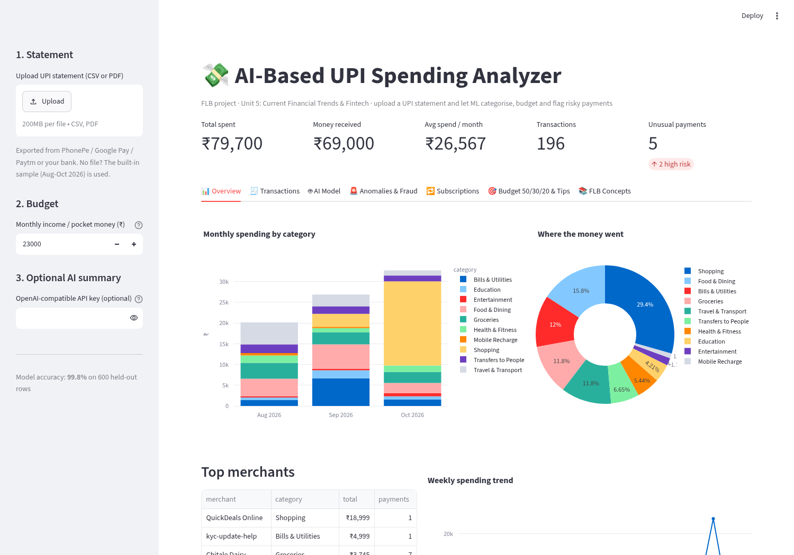

# AI-Based UPI Spending Analyzer

**FLB (Financial Literacy & Banking) group project** · Unit 5: Current Financial Trends and Fintech
SY B.Tech AI & DS, Vishwakarma University, Pune

[](https://upi-spending-analyzer-4frr9h7ggyhzpfegfarlup.streamlit.app/)

**Live demo:** https://upi-spending-analyzer-4frr9h7ggyhzpfegfarlup.streamlit.app/  
(Hosted free on Streamlit Community Cloud. If it says the app is asleep, click *Yes, get this app back up!* and wait about a minute.)

Upload a UPI statement (PhonePe / Google Pay / Paytm / bank, CSV or PDF). The app:

1. **Categorises every payment with machine learning** (TF-IDF + Logistic Regression), with keyword rules as a fallback.
2. Shows **monthly and category charts**, top merchants and a weekly trend.
3. **Flags unusual or suspicious payments**: duplicates, unusually large amounts (z-score), late-night high-value payments, scam-like payee names, and an Isolation Forest outlier model.
4. Finds **recurring payments and subscriptions** (Netflix, recharge, Wi-Fi...).
5. Compares your spending with the **50/30/20 budget rule** and gives **personalised saving tips**.
6. Optional: an **AI coach summary** from an LLM if you paste an API key. Everything else works **fully offline**.

A synthetic 3-month sample statement (Aug-Oct 2026, a Pune college student, 196 transactions, amounts in ₹) is built in, so the demo works without anyone's real bank data.



More screenshots: `docs/screenshots/` (AI model, anomalies, budget).

---

## 1. Setup (Windows, Ubuntu or WSL)

Needs Python 3.9 or newer.

```bash
cd upi-spending-analyzer
python -m venv venv
# Windows:        venv\Scripts\activate
# Ubuntu / WSL:   source venv/bin/activate
pip install -r requirements.txt
streamlit run app.py
```

The browser opens at http://localhost:8501. If `streamlit` is "not recognised", run `python -m streamlit run app.py`.

Run the tests (16 tests):

```bash
python -m pytest -q
```

Regenerate the sample data (optional, it is already in `data/`):

```bash
python -m analyzer.data_generator
```

### Using your own statement
- **CSV**: needs a date column, a description column and either an `Amount` + `Type` (DEBIT/CREDIT) column or separate `Debit`/`Credit` (`Withdrawal`/`Deposit`) columns. Common names like `Narration`, `Transaction Details`, `Txn Date` are recognised automatically. Dates like `05/10/2026` are read the Indian way (5 October).
- **PDF**: lines in the PhonePe style `Oct 05, 2026  07:45 PM  Paid to Swiggy  DEBIT  INR 250.00`. Real bank PDFs vary a lot; if one doesn't parse, export CSV/Excel from net banking instead.

---

## 2. Project structure

```
upi-spending-analyzer/
├── app.py                    # Streamlit UI (7 tabs)
├── analyzer/
│   ├── merchants.py          # merchant lists, keyword rules, scam words, needs/wants
│   ├── data_generator.py     # builds training data + sample statement (CSV + PDF)
│   ├── parser.py             # reads CSV / PDF into one clean table
│   ├── categorizer.py        # ML model: TF-IDF + Logistic Regression + rule fallback
│   ├── anomaly.py            # duplicate, z-score, late-night, scam words, Isolation Forest
│   ├── insights.py           # merchants, charts data, recurring, 50/30/20, tips
│   └── llm.py                # optional LLM summary (only with an API key)
├── data/
│   ├── training_data.csv     # 3,000 labelled UPI descriptions
│   ├── sample_upi_statement.csv
│   └── sample_upi_statement.pdf
├── tests/test_core.py        # pytest tests for the core logic
├── docs/screenshots/
└── requirements.txt
```

## 3. Architecture

```
 CSV / PDF statement
        │
        ▼
 ┌──────────────┐   date, description, DEBIT/CREDIT, amount
 │  parser.py   │──────────────────────────────────────────┐
 └──────────────┘                                          ▼
                                             ┌──────────────────────────┐
 training_data.csv ──► train once ──────────►│ categorizer.py           │
 (3,000 labelled rows)                       │ clean text → TF-IDF      │
                                             │ → Logistic Regression    │
                                             │ → if confidence < 45%:   │
                                             │   keyword rules          │
                                             └────────────┬─────────────┘
                                                          ▼
                      ┌───────────────────┬───────────────┴──────┬───────────────────┐
                      ▼                   ▼                      ▼                   ▼
               insights.py          anomaly.py             insights.py          insights.py
           charts, top merchants  duplicates, z-score,   recurring payments   50/30/20 budget
                                  late night, scam words,                     + saving tips
                                  Isolation Forest                                  │
                      └───────────────────┴──────────────────────┴───────────── (optional llm.py)
                                                          ▼
                                                   app.py (Streamlit)
```

### The AI / ML parts, in plain words

**1. Categoriser (supervised learning, text classification)**
- *Data*: 3,000 synthetic UPI descriptions with the right category, e.g. `UPI/DR/412345678901/SWIGGY/YESB/swiggy@ybl → Food & Dining`. Big brands (Swiggy, IRCTC, Jio...), local shops (`Shree Ganesh Medical`, `Balaji Petrol Pump`) and people (`Paid to Rohan Deshmukh`) in 7 app/bank formats, 15% with typos.
- *Features*: TF-IDF on **character n-grams** (2-4 letters). `SWIGGY`, `swiggy@ybl` and the typo `Swigy` share most n-grams, so they look alike to the model.
- *Model*: Logistic Regression gives a probability for each of 10 categories.
- *Fallback*: if the best probability is under 45%, keyword rules decide (e.g. "petrol" → Travel). Money received is always "Income".
- *Results*: **99.8% accuracy** on a held-out 20% test set (600 rows). On the harder test where **whole merchants are hidden** from training, it gets **62%**: it still works out new shops from words like *medical*, *kirana*, *petrol*, but a brand-new brand name with no clue in it is genuinely hard. That's why the rule fallback exists.

**2. Anomaly detection (fraud awareness)**
| Check | Rule | Why it matters |
|---|---|---|
| Duplicate payment | same payee + same amount within 10 min | double-tap / app glitch, ask for refund |
| Z-score | (log amount − mean) / std > 2.5 | amount far above your normal spending |
| Late-night high value | ≥ ₹2,000 between 12 AM and 5 AM | common pattern in account takeover fraud |
| Scam words | payee has "kyc", "refund", "lottery", "reward"... | classic UPI scam payees |
| Isolation Forest | unsupervised ML on amount + time of day | catches odd combinations the rules miss |

Each reason adds 1 point (duplicate and scam-name add 2). **3+ = High, 2 = Medium, 1 = Low.**
In the sample, it catches all three planted problems: a ₹18,999 payment at 2:13 AM, a ₹4,999 payment to `kyc-update-help@ybl`, and a double Zomato payment one minute apart.

**3. Recurring payments**: same payee, 3+ payments over 2+ months, about every 20+ days on a steady schedule, amount varying by 20% or less (coefficient of variation). Finds Netflix ₹199, Spotify ₹119, Jio ₹299 every 28 days, ACT Fibernet ₹799, Cult.fit ₹999 and the electricity bill.

**4. 50/30/20 budget**: income is auto-detected from money received (₹23,000/month in the sample; editable). Needs = groceries, travel, bills, recharge, education, health. Wants = eating out, shopping, entertainment, transfers to friends. Savings = income − needs − wants.

## 4. FLB syllabus mapping

| Feature | FLB concept |
|---|---|
| Reading UPI statements | Digital payments: UPI, NPCI, payment apps (Unit 5) |
| ML categorisation | Fintech: AI/ML in personal finance (Unit 5) |
| Charts, top merchants | Tracking expenses, personal financial planning |
| 50/30/20 budget | Budgeting: needs vs wants vs savings |
| Saving tips | Savings habits, pay yourself first, RD / SIP |
| Recurring payments | Subscription economy, UPI AutoPay / e-mandates (Unit 5) |
| Anomaly & scam detection | Banking frauds, cyber safety, RBI customer protection (Unit 3) |

---

## 5. How to explain it in class

### Suggested split for 4 members (about 1 minute each)

| Member | Part | Show in the app |
|---|---|---|
| **1** | Problem, idea, FLB link, data & parsing | Header + KPIs, upload box, *FLB Concepts* tab |
| **2** | ML categoriser | *AI Model* tab: accuracy, confusion matrix, **type a description live** |
| **3** | Fraud / anomaly detection | *Anomalies & Fraud* tab: the 2 AM payment, scam payee, duplicate |
| **4** | Budgeting, subscriptions, tips, conclusion | *Subscriptions* + *Budget 50/30/20 & Tips* tabs |

### 3-4 minute talking script

**Member 1 (problem & idea, ~50 s)**
"Good morning. India does more than 15 billion UPI payments a month, and most of them are small: ₹30 chai, ₹150 auto, ₹400 Swiggy. Because UPI is so easy, people, especially students, lose track of where their money goes. Our project, the **AI-Based UPI Spending Analyzer**, is from Unit 5, Fintech. You upload your UPI statement from PhonePe, GPay, Paytm or your bank, as CSV or PDF, and the app uses AI to categorise every payment, build a budget, find subscriptions and warn you about suspicious payments. For the demo we made a realistic 3-month statement of a Pune student, so no one's real bank data is used. Here you can see ₹79,700 spent in three months and five unusual payments."

**Member 2 (the ML model, ~60 s)**
"The core AI part is a text classifier. A UPI statement only gives a line like `UPI/DR/4123.../SWIGGY/YESB/swiggy@ybl`. We first clean it, removing reference numbers and bank codes. Then **TF-IDF on character n-grams** turns the text into numbers; small 2-4 letter pieces mean even a typo like 'Swigy' still matches. A **Logistic Regression** model then predicts one of 10 categories, like Food, Travel, Bills, Recharge, Education, or Transfers to people. We trained it on 3,000 labelled examples. It scores **99.8%** on the test set, and **62%** on shops it has never seen, so when it isn't confident, below 45%, keyword rules take over. Let me type one live... 'Paid to Shree Krishna Medical': it says Health."

**Member 3 (fraud detection, ~60 s)**
"Unit 3 talks about banking frauds, so we added anomaly detection. We use four simple checks and one ML model. One, **duplicate payments**: same payee and amount within 10 minutes. Two, the **z-score**: how many standard deviations a payment is above normal. Three, **high-value payments late at night**. Four, **scam words** in the payee, like 'KYC' or 'refund'. And an **Isolation Forest**, an unsupervised model that isolates odd combinations of amount and time. Look: a ₹18,999 payment at 2:13 AM is marked High risk, the ₹4,999 to 'kyc-update-help' is a classic KYC scam, and here Zomato was paid twice in one minute. We also show RBI's advice: you never need your PIN to *receive* money, and fraud can be reported on 1930."

**Member 4 (budgeting & conclusion, ~60 s)**
"Finally, financial planning. The app finds **recurring payments**: Netflix, Spotify, Jio every 28 days, Wi-Fi, gym. That's money committed every month before you spend anything. Then we apply the **50/30/20 rule**: 50% needs, 30% wants, 20% savings. On ₹23,000 income, this student spends 62% on wants and saves nothing; but without the two high-risk payments, they would be saving. The app gives personal tips: cut food delivery, watch small 'latte-factor' payments, and invest the surplus through an RD or SIP on the day money comes in. In future we could connect to the **RBI Account Aggregator** framework to fetch statements automatically. Thank you, we're happy to take questions."

### Live demo checklist
- Start the app *before* your turn: `streamlit run app.py`, keep the tab open.
- Keep the sample statement loaded (no upload needed). Optional: upload `data/sample_upi_statement.pdf` to show PDF works.
- Member 2: type a new description in **Try it live** (e.g. "Paid to Om Sai Kirana Stores").
- Member 4: change the income box (e.g. 30000) and the budget updates instantly.
- No internet needed. Don't paste an API key in class unless you want to demo the AI coach.

### Likely viva questions and answers

**Q1. Where is the AI in this project?**
Two places. A supervised text classifier (TF-IDF + Logistic Regression) categorises transactions, and an unsupervised Isolation Forest finds unusual payments. The optional LLM only writes a summary.

**Q2. Why Logistic Regression and not deep learning / BERT?**
Our descriptions are short (a few words), the data is small (3,000 rows), and Logistic Regression trains in under a second, runs offline, and is easy to explain: it gives a probability per category. It already scores 99.8% on the test set, so a heavy model isn't needed.

**Q3. What is TF-IDF?**
Term Frequency × Inverse Document Frequency. It gives a high weight to pieces of text that appear in this description but are rare across all descriptions. We use character n-grams (2-4 letters) instead of whole words so typos and joined words like `swiggy@ybl` still match.

**Q4. Where did the training data come from? Isn't 99.8% too good?**
It's synthetic: we generated realistic descriptions from lists of Indian merchants, local shop names and people's names in 7 formats, with 15% typos. 99.8% is high because test rows share merchants with training rows. That's why we also report 62% on completely unseen merchants, which is the honest real-world number, and why we added keyword rules as a fallback.

**Q5. How does the app know a payment is to a person and not a shop?**
The model learned that patterns like "Paid to Firstname Lastname" and personal UPI handles (`@okhdfcbank`, `@oksbi`) mean a transfer. The rules also check for that pattern.

**Q6. What is a z-score?**
z = (value − mean) / standard deviation: how many standard deviations a payment is from your normal. We use the log of the amount because spending is skewed (lots of small payments, few big ones). Above 2.5 is flagged.

**Q7. What is Isolation Forest?**
An unsupervised algorithm that builds random decision trees. Unusual points get separated (isolated) in very few splits, so a short path means an outlier. It needs no labelled fraud data, which banks rarely share. We set contamination to 2%.

**Q8. Will it flag genuine payments? (false positives)**
Yes, sometimes. For example the ₹3,450 MakeMyTrip booking is marked Medium. That's why we show a risk level and the reasons instead of blocking anything: it's a "second look" list for the user.

**Q9. What is the 50/30/20 rule?**
Split take-home income into 50% needs, 30% wants and 20% savings. It's a simple budgeting rule from personal finance.

**Q10. How are recurring payments detected?**
Same payee, at least 3 payments over 2+ months, a steady gap of about 20+ days, and an amount that varies 20% or less (coefficient of variation = std / mean).

**Q11. How is the user's data kept private?**
Everything runs locally on the laptop. Nothing is uploaded anywhere. The optional LLM mode sends only totals (no descriptions or names), and only if the user enters a key.

**Q12. What is UPI and who runs it?**
Unified Payments Interface, launched in 2016 by NPCI (National Payments Corporation of India) under RBI. It links bank accounts to a mobile app for instant 24×7 transfers using a UPI ID and PIN.

**Q13. Can it read real PhonePe/GPay statements?**
CSV exports with common column names work. PDF layouts differ between apps and banks; ours reads the PhonePe-style line format. Adding a new format means adding one pattern in `parser.py`.

**Q14. Limitations and future scope?**
Synthetic training data, a fixed set of 10 categories, and PDF formats vary. Future: train on real labelled data, let users correct categories (active learning), fetch statements through the RBI Account Aggregator framework, monthly budget alerts, and a mobile app.

**Q15. Which libraries did you use?**
Python, Streamlit (UI), pandas (data), scikit-learn (TF-IDF, Logistic Regression, Isolation Forest), Plotly (charts), pdfplumber (PDF reading), fpdf2 (making the sample PDF), pytest (tests).

---

*All sample data is synthetic. Names of merchants are used only as realistic examples.*
